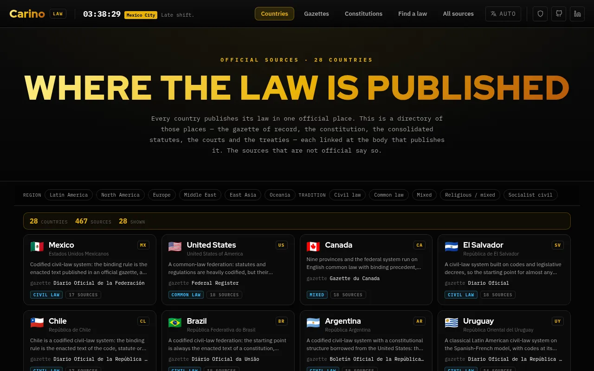

# Carino Law

A map of where law is *officially published*, for twenty-eight countries.

**[law.carino.systems](https://law.carino.systems)**



Every country has one channel where a law stops being a proposal and becomes binding — the
**Diario Oficial de la Federación** in Mexico, the **Journal Officiel** in France, the **官報** in
Japan, the **Bundesgesetzblatt** in Germany, **The Gazette** in the UK. Everything else — the consolidated text you actually read, the
commercial database your firm pays for, the English translation — is downstream of that channel and
is, legally, a convenience copy.

This site is the directory of those channels. For each country: the gazette of record, the
constitution, the consolidated statute databases, the courts, the treaty registers, the subnational
gazettes — linked at the publisher, with the ones that aren't official marked as not official.

It is a finding aid. It contains no legal advice, no summaries of what any law says, and no
opinions about any of them.

## What's in a country record

| | |
|---|---|
| **Summary** | who makes law, where it is published, when it takes effect, what counts as the authentic text |
| **Hierarchy of norms** | the ladder from the constitution down to municipal by-laws |
| **Gazette of record** | the single official publication channel, with how to search it |
| **Constitution** | the official text — and, for the UK, New Zealand and Israel, an honest account of what stands in its place |
| **Sources** | consolidated law, legislature, courts, case law, regulations, treaties, subnational, translations |
| **Looking something up** | task-shaped recipes: current text of a statute, what changed, case law, regulations, state law |
| **Subnational** | whether states or provinces legislate, who publishes them, where to start |
| **What is not authoritative** | the caveats — consolidation gaps, unofficial translations, paywalls, sites that look official and aren't |

Each source carries its publisher, language, coverage dates, access level (free / registration /
part-paywalled / paywalled), a bulk-download or API endpoint where one exists, and a sentence on how
to actually find something on that particular site.

## The official / unofficial line

This is the one distinction the site exists to make, so it is drawn on a factual test — **who
publishes it**, not how good it is.

`official: true` means a government body or the state's designated publisher. `official: false`
means anyone else. CanLII, AustLII, NZLII, Nevo, ConsultantPlus, Beida Fabao and Westlaw Japan are
all marked unofficial, and they are all included, because in several of these countries they are
what practitioners actually open. Marking them honestly and listing them anyway is the point;
pretending they don't exist would be less useful and no more accurate.

## Running it

Open `index.html` — but over `http://`, not `file://`, because it fetches the data files and
browsers block `fetch()` on `file://`:

```
python3 -m http.server
```

No build step, no dependencies, no CDN, no network calls at runtime beyond the data files. Fonts are
self-hosted. It works offline once loaded.

Five views over the same data — countries, gazettes, constitutions, find a law, all sources — each
narrowed by chips for region, legal tradition and source kind. There is no search box: twenty-eight
countries and a few hundred sources are small enough that the filters reach any of it in one click,
and a filter shows you what it is filtering by.

## The data

One JSON file per country in `data/countries/`, listed in `data/index.json`. The files *are* the
document — the site is a renderer over them and adds nothing. To add a country, write one file and
add one line to the index.

The interface is translated into Spanish, Portuguese, Japanese and Russian (`i18n.js`, following the
fleet convention). **The country records are not translated and deliberately stay in English.** The
name of a gazette, the description of a court database and the caveat about which text is
authoritative are research, not interface copy; a machine translation of them would be a liability
rather than a feature.

## Tools

The site's only real promise is that the links go where it says they go, and government sites move
constantly, so that promise decays unless something re-checks it.

| | |
|---|---|
| `python3 tools/validate.py` | schema, vocabulary, duplicate ids, thin countries |
| `python3 tools/linkcheck.py` | fetches every URL and sorts the results into ok / redirected / blocked / TLS / dead |

`linkcheck.py` separates a **404** from a **403**: several legitimate government sites answer an
automated request with a bot wall while serving a browser fine, so those are reported for a human to
eyeball rather than counted as failures. Only genuinely dead links fail the run. Run both before any
commit that touches `data/`.

## Limits

- **Twenty-eight countries**, not all of them. Chosen to span common law, civil law, mixed,
  religious-mixed and socialist-civil systems across six regions rather than to be exhaustive.
- **A snapshot.** Every URL was fetched and confirmed when the record was written; the date is in
  each file's `updated` field. Nothing here re-checks itself.
- **Not a substitute for the source.** Where a country's authentic text exists only in its own
  language, or only in a printed edition, or only behind a login, the record says so — but it is
  still the source that governs, not this page.
- **Not legal advice**, and not a citator. It tells you where a document lives, not what it means or
  whether it is still good law.
